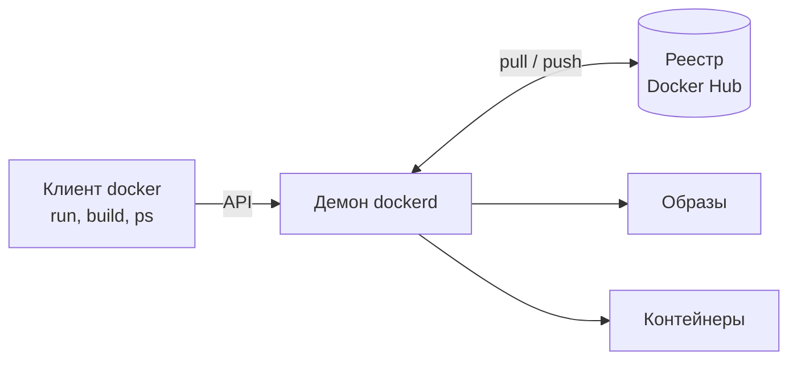
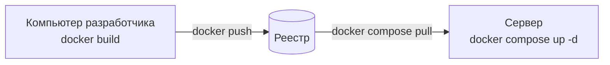

# 2.2. Контейнеризация

Образы и контейнеры, Dockerfile, тома и сети, Docker Compose, развёртывание
приложений

---
layout: default
---

# «У меня работает»

Приложение запускается на ноутбуке разработчика и падает на сервере. Код
один и тот же. Отличается окружение:

<v-clicks>

- версия Python: на сервере 3.10, код написан под 3.12
- версии библиотек: в `requirements.txt` не указаны точные версии
- системные пакеты: драйвер базы данных, шрифты, компилятор
- переменные окружения и файлы настроек
- сама операционная система

</v-clicks>

<v-click>

Контейнер упаковывает приложение вместе с окружением. На сервер переезжает
уже собранная коробка, и внутри у неё всё то же, что было у разработчика.

</v-click>

---
layout: default
---

# План на сегодня

<v-clicks>

- Что такое контейнер и чем он отличается от виртуальной машины
- Запуск готовых контейнеров
- Свой образ: Dockerfile, слои, кэш сборки, размер
- Данные и сеть: тома, DNS между контейнерами
- Docker Compose: приложение из нескольких сервисов
- Развёртывание и где встречаются контейнеры

</v-clicks>

---
layout: default
---

# Напоминание

<v-clicks>

- **Процесс**: запущенная программа со своим номером (PID), памятью и открытыми файлами
- **Порт**: номер, на котором сетевая программа принимает соединения; `localhost:8000` означает порт 8000 на этом же компьютере
- **Переменная окружения**: строка `ИМЯ=значение`, которую процесс получает при запуске; в Python её читают через `os.environ["ИМЯ"]`
- **`requirements.txt`**: список библиотек проекта, ставится командой `pip install -r requirements.txt`

</v-clicks>

---
layout: default
---

# Идея из морского порта

Раньше грузы везли россыпью: мешки, бочки, ящики разной формы, и каждый
грузили по-своему. Стандартный морской контейнер свёл всё к одной коробке.
Кран, судно и грузовик работают с ней одинаково и не знают, что внутри.

<v-click>

Контейнер Docker устроен так же. Это стандартная упаковка для программы:
Docker запускает её одинаково, будь внутри веб-сервер на Python, база
данных или бот. Отсюда и название, и кит с контейнерами на логотипе.

</v-click>

---
layout: default
clicks: 3
---

# Виртуальная машина и контейнер

<VmVsContainer :step="$clicks" />

---
layout: default
---

# Как Linux изолирует процессы

Контейнер является обычным процессом Linux, которому ядро ограничило
обзор и ресурсы.

<v-clicks>

- **Пространства имён** (namespaces) определяют, что процесс видит: свои номера процессов, сеть, имя хоста, файловую систему
- **Контрольные группы** (cgroups) определяют, сколько он может потреблять: память, процессорное время
- Внутри контейнера главный процесс считает себя первым: у него PID 1
- Снаружи это рядовой процесс в общем списке процессов

</v-clicks>

---
layout: default
---

# Docker на Windows и macOS

Контейнерам нужно ядро Linux. На Windows и macOS Docker Desktop запускает
небольшую виртуальную машину с Linux (на Windows через WSL 2), и контейнеры
работают внутри неё.

<Terminal k="version,info_os" cmd="docker version --format ...||docker info --format {{.OperatingSystem}}" />

<v-click>

Клиент `docker` работает в вашей системе, а сервер, который запускает
контейнеры, работает в Linux. Поэтому один и тот же образ
запускается на любом компьютере с Docker.

</v-click>

---
layout: default
---

# Ключевые слова

| Термин | Что это |
|---|---|
| Образ (image) | Шаблон только для чтения: файлы приложения и окружения плюс команда запуска |
| Контейнер (container) | Запущенный экземпляр образа со своим слоем для записи |
| Слой (layer) | Изменения файлов, которые внесла одна инструкция сборки |
| Dockerfile | Текстовый файл с инструкциями для сборки образа |
| Реестр (registry) | Хранилище образов; по умолчанию Docker Hub |
| Тег (tag) | Версия образа после двоеточия: `python:3.12-slim` |
| Том (volume) | Хранилище данных, которое живёт отдельно от контейнера |
| Docker Compose | Описание приложения из нескольких контейнеров в одном файле |

<style>
.slidev-layout table { font-size: 0.74em; }
</style>

---
layout: default
---

# Как устроен Docker

Команда `docker` служит только клиентом. Работу выполняет демон `dockerd`: он
скачивает образы из реестра, собирает новые и запускает контейнеры.



---
layout: default
---

# Образ и контейнер: класс и объект

<div class="grid grid-cols-2 gap-6">
<div>

```python
class Counter:            # описание
    ...

a = Counter()             # экземпляр 1
b = Counter()             # экземпляр 2
```

</div>
<div>

```bash
docker build -t counter .   # образ
docker run counter          # контейнер 1
docker run counter          # контейнер 2
```

</div>
</div>

<v-click>

Из одного образа запускается сколько угодно контейнеров. Слои образа у них
общие, как методы у объектов одного класса. Собственный у каждого только
слой для записи, как набор атрибутов у объекта.

</v-click>

---
layout: default
---

# Команда `docker run`

`docker run [флаги] образ [команда]` создаёт контейнер из образа и
запускает в нём команду. Без команды выполняется та, что записана в образе.

| Флаг | Что делает |
|---|---|
| `--rm` | Удалить контейнер после завершения |
| `-d` | Запустить в фоне и вернуть управление терминалу |
| `-it` | Интерактивный режим: ввод с клавиатуры и терминал |
| `--name web` | Задать имя контейнеру |
| `-p 8080:8000` | Связать порт 8080 компьютера с портом 8000 контейнера |
| `-e КЛЮЧ=значение` | Передать переменную окружения |
| `-v notes:/data` | Подключить том `notes` в папку `/data` |

---
layout: default
---

# Первый запуск

Образ `hello-world` печатает приветствие и сам объясняет, что произошло.

<Terminal k="hello" cmd="docker run --rm hello-world" small />

---
layout: default
---

# Что произошло

<v-clicks>

- Клиент передал команду демону
- Демон не нашёл образ на диске и скачал его из Docker Hub
- Создал из образа контейнер
- Запустил в нём программу и передал её вывод клиенту
- Программа завершилась, контейнер остановился, а флаг `--rm` его удалил
- Повторный запуск обойдётся без скачивания: образ уже на диске

</v-clicks>

---
layout: default
---

# Python в контейнере

<Terminal k="python_info,os_release" match="^3\.|PRETTY_NAME" cmd="docker run --rm python:3.12-slim python -c ...||docker run --rm python:3.12-slim cat /etc/os-release" />

<v-clicks>

- Версию Python задаёт образ. На самом компьютере Python может не стоять вовсе
- Внутри Linux, даже если Docker запущен на Windows
- `docker run -it --rm python:3.12-slim` открывает интерактивный Python внутри контейнера, `exit()` его закрывает

</v-clicks>

---
layout: default
clicks: 5
---

# Жизненный цикл контейнера

<ContainerLifecycle :step="$clicks" />

---
layout: default
---

# Жизненный цикл в выводе

`docker ps -a` показывает все контейнеры, включая остановленные. Колонка
STATUS меняется вместе с состоянием.

<Terminal k="life_create,life_ps1,life_start,life_ps2,life_rm" cmd="docker create --name life-demo ...||docker ps -a||docker start -a life-demo||docker ps -a||docker rm life-demo" tiny />

---
layout: center
---

# Свой образ

Готовых образов в Docker Hub тысячи. Своё приложение упаковывается в
собственный образ, и для этого пишут Dockerfile.

---
layout: default
---

# Сквозной пример: веб-сервер

Небольшой сервер на стандартной библиотеке Python. На любой запрос отвечает
приветствием и называет имя хоста, на котором работает.

```python
import signal, socket, sys
from http.server import BaseHTTPRequestHandler, HTTPServer

class Handler(BaseHTTPRequestHandler):
    def do_GET(self):
        text = f"Привет из контейнера {socket.gethostname()}\n"
        self.send_response(200)
        self.send_header("Content-Type", "text/plain; charset=utf-8")
        self.end_headers()
        self.wfile.write(text.encode())

signal.signal(signal.SIGTERM, lambda *args: sys.exit(0))  # для docker stop
print("Сервер слушает порт 8000", flush=True)
HTTPServer(("0.0.0.0", 8000), Handler).serve_forever()
```

---
layout: default
---

# Инструкции Dockerfile

| Инструкция | Что делает |
|---|---|
| `FROM образ` | Берёт базовый образ, с которого начинается сборка |
| `WORKDIR /app` | Создаёт папку и делает её текущей для следующих инструкций |
| `COPY откуда куда` | Копирует файлы с компьютера в образ |
| `RUN команда` | Выполняет команду при сборке, например установку библиотек |
| `ENV ИМЯ=значение` | Задаёт переменную окружения внутри образа |
| `EXPOSE 8000` | Документирует порт, который слушает приложение |
| `CMD ["python", "app.py"]` | Команда, которая выполнится при запуске контейнера |

---
layout: default
---

# Dockerfile первой версии

```dockerfile
FROM python:3.12-slim
WORKDIR /app
COPY app.py .
EXPOSE 8000
CMD ["python", "app.py"]
```

<v-clicks>

- Файл называется `Dockerfile` и лежит рядом с `app.py`
- Сборка: `docker build -t counter:v1 .`
- `-t counter:v1` даёт образу имя `counter` и тег `v1`
- Точка в конце означает текущую папку: контекст сборки, из которого `COPY` берёт файлы

</v-clicks>

---
layout: default
---

# Сборка образа

<Terminal k="build_v1" cmd="docker build -t counter:v1 ." match="^#\d+ \[\d|naming to" :trim="110" />

<v-click>

Каждая инструкция выполняется отдельным шагом: `[1/3]`, `[2/3]`, `[3/3]`.
Инструкции `EXPOSE` и `CMD` только записывают настройки и шагами не
считаются. Готовый образ сохранён под именем `counter:v1`.

</v-click>

---
layout: default
---

# Запуск в фоне

<Terminal k="run_v1,curl_v1,ps_v1" cmd="docker run -d --name counter-web -p 8080:8000 counter:v1||curl http://localhost:8080||docker ps" tiny />

<v-clicks>

- `-d` запускает контейнер в фоне и печатает его полный ID
- `curl` (или браузер) обращается к порту 8080 компьютера, и отвечает сервер из контейнера
- `docker ps` показывает работающие контейнеры, колонка PORTS показывает проброс порта

</v-clicks>

---
layout: default
clicks: 3
---

# Проброс порта

<PortMap :step="$clicks" />

---
layout: default
---

# Логи и команды внутри контейнера

<Terminal k="logs_v1,exec_hostname" cmd="docker logs counter-web||docker exec counter-web hostname" />

<v-clicks>

- `docker logs` показывает всё, что приложение напечатало в стандартный вывод и поток ошибок
- `docker exec` выполняет команду в уже работающем контейнере
- Имя хоста внутри контейнера совпадает с коротким ID контейнера: его же назвал сервер в ответе

</v-clicks>

---
layout: default
---

# Изоляция на деле

<Terminal k="exec_pid1,top_v1" cmd="docker exec counter-web cat /proc/1/cmdline||docker top counter-web" tiny />

<v-click>

Внутри контейнера `python app.py` получил номер 1. `docker top` показывает
тот же процесс снаружи, с обычным номером из общего списка (на Windows и
macOS из списка процессов виртуальной машины Docker). Так работает
пространство имён процессов.

</v-click>

---
layout: default
---

# Остановка и сигнал SIGTERM

`docker stop` посылает главному процессу сигнал SIGTERM и ждёт, пока тот
завершится. Если процесс не завершился за отведённое время, Docker убивает
его сигналом SIGKILL. Время ожидания задаёт флаг `-t`.

| Главный процесс контейнера | `docker stop` | Код выхода |
|---|---|---|
| `python app.py` с обработчиком SIGTERM | <Num k="stop_v1" /> | **0** |
| `python -c "import time; time.sleep(600)"` без обработчика | <Num k="sleeper_stop" /> | **137** |

<v-click>

Процессу с PID 1 ядро не применяет действие сигнала по умолчанию: без
обработчика SIGTERM просто игнорируется, и процесс дожидается SIGKILL.
Код 137 означает 128 + 9: процесс убит сигналом номер 9, это SIGKILL.
После него программа уже не закроет соединения и не сохранит данные.
Поэтому в `app.py` есть строка `signal.signal(signal.SIGTERM, ...)`.

</v-click>

---
layout: default
---

# Переменные окружения

<Terminal k="env_var" cmd="docker run --rm -e APP_MODE=production python:3.12-slim python -c ..." />

<v-clicks>

- `-e ИМЯ=значение` передаёт переменную в контейнер, код читает её через `os.environ`
- Так задают всё, что меняется от компьютера к компьютеру: адреса сервисов, режим работы, ключи доступа
- Один и тот же образ работает на ноутбуке и на сервере, отличаются только переменные

</v-clicks>

---
layout: default
clicks: 4
---

# Ловушка: сервер слушает 127.0.0.1

<PortMap bad :step="Math.min($clicks, 3)" />

<v-click at="4">

<Terminal k="curl_bind" label="запрос к порту 8081 из Python (urllib)" small />

</v-click>

---
layout: default
clicks: 6
---

# Из чего состоит образ

<ImageLayers :step="$clicks" />

---
layout: default
---

# `docker history`

<Terminal k="history_good" cmd="docker history counter:good" :trim="112" tiny />

<v-click>

Сверху последняя инструкция, снизу слои базового образа. Колонка SIZE
показывает, сколько места добавил каждый слой.

</v-click>

---
layout: default
clicks: 3
---

# Кэш сборки

<BuildCache :step="$clicks" />

---
layout: default
---

# Кэш в выводе сборки

<Terminal k="build_good_rebuild,build_bad_rebuild" cmd="docker build -t counter:good .||docker build -f Dockerfile.bad -t counter:bad ." match="^#\d+ \[\d|CACHED|Successfully installed" :trim="96" small />

<v-click>

После правки `app.py` первый вариант взял `pip install` из кэша, второй
выполнил его заново.

</v-click>

---
layout: default
---

# `.dockerignore`

<div class="grid grid-cols-2 gap-6">
<div>

```text
.venv/
__pycache__/
*.pyc
.env
.git/
```

</div>
<div>

Файл `.dockerignore` перечисляет, что не отправлять в контекст сборки.
Виртуальное окружение, кэш Python и история git образу не нужны. Файл
`.env` с паролями тем более.

</div>
</div>

<v-click>

Проект с тяжёлой папкой `.venv` и `COPY . .` в Dockerfile:

<div class="grid grid-cols-2 gap-6">
<div>

Без `.dockerignore`: образ <Num bytes="ctx_size_without" />

<Terminal k="ctx_without" after="load build context" no-cmd small />

</div>
<div>

С `.dockerignore`: образ <Num bytes="ctx_size_with" />

<Terminal k="ctx_with" after="load build context" no-cmd small />

</div>
</div>

</v-click>

---
layout: default
---

# Размер базового образа

| Образ | Что внутри | Скачивается | На диске |
|---|---|---|---|
| `python:3.12` | Debian с компиляторами и заголовочными файлами | <Num ls="python:3.12" col="content" /> | <Num ls="python:3.12" col="disk" /> |
| `python:3.12-slim` | Debian без лишних пакетов | <Num ls="python:3.12-slim" col="content" /> | <Num ls="python:3.12-slim" col="disk" /> |
| `python:3.12-alpine` | Alpine Linux на библиотеке musl | <Num ls="python:3.12-alpine" col="content" /> | <Num ls="python:3.12-alpine" col="disk" /> |

Числа из `docker image ls` (CONTENT SIZE и DISK USAGE). Слои скачиваются
сжатыми, на диске хранятся и сжатыми, и распакованными.

<v-click>

Для большинства приложений подходит slim. Alpine ещё меньше, но вместо
обычной glibc использует musl: для части пакетов готовых сборок под неё
нет, и pip компилирует их из исходников.

</v-click>

<style>
.slidev-layout th, .slidev-layout td:first-child { white-space: nowrap; }
</style>

---
layout: default
---

# Многоступенчатая сборка

```dockerfile
FROM python:3.12 AS builder
WORKDIR /app
COPY requirements.txt .
RUN pip wheel --no-cache-dir -r requirements.txt -w /wheels

FROM python:3.12-slim
WORKDIR /app
COPY --from=builder /wheels /wheels
RUN pip install --no-cache-dir /wheels/*
COPY app.py .
CMD ["python", "app.py"]
```

<v-click>

Первая стадия собирает пакеты в полном образе со средствами сборки. Вторая
копирует только готовые файлы в лёгкий slim. В итоговый образ попадает
последняя стадия.

</v-click>

---
layout: default
---

# CMD: две формы записи

```dockerfile
CMD ["python", "app.py"]    # exec-форма: python становится PID 1
CMD python app.py           # shell-форма: команду запускает /bin/sh
```

<Terminal k="shell_pid1" cmd="docker exec shell-demo cat /proc/1/cmdline" />

<v-click>

В shell-форме процесс номер 1 занимает оболочка `sh`, и SIGTERM до Python
не доходит. Тот же `app.py` с обработчиком сигнала в shell-форме
останавливается за <Num k="shell_stop" />, в exec-форме за <Num k="stop_v1" />.
Поэтому `CMD` пишут в exec-форме, списком.

</v-click>

---
layout: default
---

# Публикация образа

```bash
docker tag counter:v1 username/counter:1.0   # имя в реестре
docker login                                 # вход в Docker Hub
docker push username/counter:1.0             # отправка
docker pull username/counter:1.0             # на другом компьютере
```

<v-clicks>

- Имя образа в реестре включает владельца: `username/counter`
- Кроме Docker Hub есть GitHub Container Registry (`ghcr.io`) и реестры облачных провайдеров
- Компании держат собственные закрытые реестры

</v-clicks>

---
layout: center
---

# Данные и сеть

Контейнер задуман одноразовым: его удаляют и создают заново при каждом
обновлении. Данные и связи между контейнерами настраиваются отдельно.

---
layout: default
---

# Файлы живут вместе с контейнером

<Terminal k="novol_write,novol_rm,novol_read" cmd="docker run --name notes-demo python:3.12-slim sh -c ...||docker rm notes-demo||docker run --rm python:3.12-slim cat /notes.txt" />

<v-click>

Файл записан в слой контейнера и удалён вместе с ним. Новый контейнер
получает чистую копию образа.

</v-click>

---
layout: default
clicks: 3
---

# Том

<VolumeLife :step="$clicks" />

---
layout: default
---

# Том в выводе

<Terminal k="vol_create,vol_write,vol_read,vol_inspect" cmd="docker volume create notes||docker run --rm -v notes:/data python:3.12-slim sh -c ...||docker run --rm -v notes:/data python:3.12-slim cat /data/notes.txt||docker volume inspect notes" match="^\w|Mountpoint|Name" small />

<v-click>

Заметку записал один контейнер и прочитал другой. Сами файлы тома лежат в
папке, которой управляет Docker (`Mountpoint`).

</v-click>

---
layout: default
---

# Тома и папки компьютера

| | Том | Папка компьютера (bind mount) |
|---|---|---|
| Запись | `-v notes:/data` | `-v /home/user/project:/app` |
| Где данные | В хранилище Docker | В указанной папке компьютера |
| Кто управляет | Docker: `docker volume ls`, `rm` | Пользователь, как обычной папкой |
| Когда | Базы данных, загруженные файлы | Код при разработке, файлы настроек |

---
layout: default
---

# Сеть контейнеров

<v-clicks>

- Каждый контейнер получает свой адрес во внутренней сети Docker
- В собственной сети (`docker network create`) контейнеры находят друг друга по имени: Docker держит для них встроенный DNS
- В сети по умолчанию поиска по имени нет
- Флаг `-p` нужен только для доступа с компьютера; внутри одной сети контейнеры обращаются к портам друг друга напрямую

</v-clicks>

---
layout: default
---

# DNS между контейнерами

<Terminal k="net_create,net_cache,net_dns,net_ping,net_default" cmd="docker network create demo-net||docker run -d --name cache --network demo-net redis:7-alpine||docker run --rm --network demo-net python:3.12-slim python -c ...||docker run --rm --network demo-net redis:7-alpine redis-cli -h cache ping||docker run --rm python:3.12-slim python -c ..." match="^[0-9a-f]{12,}$|^\d+\.|PONG|Error|error" :trim="100" small />

<v-click>

В сети `demo-net` имя `cache` превратилось в адрес, и `redis-cli` получил
ответ PONG. Тот же запрос из сети по умолчанию имени не находит.

</v-click>

---
layout: default
---

# `localhost` внутри контейнера

<Terminal k="net_localhost" cmd="docker run --rm --network demo-net python:3.12-slim python -c ..." match="Error" />

<v-click>

Для контейнера `localhost` означает сам контейнер. Redis работает в
соседнем контейнере, и обращаться к нему нужно по имени: `cache`.

</v-click>

---
layout: center
---

# Docker Compose

Настоящее приложение редко состоит из одного контейнера. Сервер, база
данных, кэш, очередь: всё это нужно запустить вместе и связать.

---
layout: default
---

# Три команды вручную

```bash
docker network create counter-net
docker run -d --name redis --network counter-net \
  -v redis-data:/data redis:7-alpine
docker run -d --name web --network counter-net \
  -p 8080:8000 -e REDIS_HOST=redis counter:good
```

<v-clicks>

- Порядок важен: сеть, потом Redis, потом сервер
- Всё это нужно повторять при каждом запуске, на каждом компьютере
- Опечатка в имени сети или переменной ломает связь между сервисами
- Docker Compose описывает то же самое одним файлом

</v-clicks>

---
layout: default
---

# Счётчик посещений

Вторая версия сервера хранит счётчик в Redis, хранилище «ключ-значение» в
памяти с сохранением на диск. Адрес Redis приходит из переменной
`REDIS_HOST`.

```python
import redis

db = redis.Redis(host=os.environ["REDIS_HOST"], port=6379)

class Handler(BaseHTTPRequestHandler):
    def do_GET(self):
        try:
            text = f"Посещений: {db.incr('visits')}, контейнер {socket.gethostname()}\n"
            code = 200
        except redis.ConnectionError as error:
            text, code = f"Ошибка Redis: {error}\n", 500
        ...  # отправка ответа, как в первой версии
```

В `requirements.txt` одна строка: `redis==5.2.1`.

---
layout: default
---

# Ключевые слова `compose.yaml`

| Ключ | Что задаёт |
|---|---|
| `services` | Список сервисов; каждый сервис становится контейнером |
| `build: .` | Собрать образ из Dockerfile в этой папке |
| `image` | Взять готовый образ из реестра |
| `ports` | Проброс портов, как `-p` |
| `env_file` / `environment` | Переменные окружения из файла или списком |
| `volumes` | Тома и папки, как `-v`; на верхнем уровне объявляются именованные тома |
| `depends_on` | Порядок запуска: от каких сервисов зависит этот |
| `healthcheck` | Команда, которой Docker проверяет, что сервис готов |

<style>
.slidev-layout table { font-size: 0.76em; }
</style>

---
layout: default
---

# `compose.yaml` счётчика

<div class="grid grid-cols-2 gap-6">
<div>

```yaml
services:
  web:
    build: .
    ports:
      - "8080:8000"
    env_file: .env
    depends_on:
      redis:
        condition: service_healthy
```

</div>
<div>

```yaml
  redis:
    image: redis:7-alpine
    volumes:
      - redis-data:/data
    healthcheck:
      test: ["CMD", "redis-cli", "ping"]
      interval: 2s
      retries: 5

volumes:
  redis-data:
```

</div>
</div>

Справа продолжение того же файла. Сеть отдельно описывать не нужно: Compose
создаёт её сам.

---
layout: default
---

# Файл `.env`

```bash
REDIS_HOST=redis
```

<v-clicks>

- `env_file: .env` передаёт переменные из файла в контейнер `web`
- `redis` в значении совпадает с именем сервиса: по нему DNS Docker найдёт контейнер
- В `.env` хранят адреса, пароли и ключи API, поэтому его добавляют в `.dockerignore` и `.gitignore`
- На сервере лежит свой `.env` со своими значениями, а образ остаётся тем же

</v-clicks>

---
layout: default
clicks: 6
---

# Что делает `docker compose up`

<ComposeUp :step="$clicks" />

---
layout: default
---

# `docker compose up` в выводе

<Terminal k="compose_up,compose_ps" cmd="docker compose up -d --build||docker compose ps" match="^\s*(Container .* (Started|Healthy|Waiting)|(Network|Volume) .* Created)\s*$|^NAME|^counter-" dedupe tiny />

<v-click>

Compose собрал образ `web`, создал сеть и том, дождался состояния healthy у
Redis и только потом запустил сервер. Имена контейнеров составлены из имени
проекта (папки), сервиса и номера.

</v-click>

---
layout: default
---

# Счётчик работает

<Terminal k="curl_c1,curl_c2,curl_c3,compose_logs" cmd="curl http://localhost:8080||curl http://localhost:8080||curl http://localhost:8080||docker compose logs web" />

---
layout: default
---

# «Запущен» ещё не значит «готов»

<v-clicks>

- Короткая запись `depends_on: [redis]` ждёт только запуска контейнера Redis
- Первые доли секунды Redis загружает данные и соединения ещё не принимает
- `healthcheck` задаёт команду, которую Docker регулярно выполняет внутри контейнера; здесь `redis-cli ping` каждые 2 с
- `condition: service_healthy` запускает `web`, только когда проверка прошла

</v-clicks>

---
layout: default
---

# Данные переживают перезапуск

<Terminal k="compose_down,compose_up2,curl_c4,compose_down_v,compose_up3,curl_c5" cmd="docker compose down||docker compose up -d||curl http://localhost:8080||docker compose down -v||docker compose up -d||curl http://localhost:8080" match="Removed|Volume .* Removed|Посещений|Container counter-web-1 Started" dedupe tiny />

<v-click>

`down` удаляет контейнеры и сеть, но том `redis-data` остаётся, и счётчик
продолжает считать. `down -v` удаляет и тома: счётчик начинается с 1.

</v-click>

---
layout: default
---

# Команды Compose

| Команда | Что делает |
|---|---|
| `docker compose up -d` | Создать и запустить все сервисы в фоне |
| `docker compose up -d --build` | То же, предварительно пересобрав образы |
| `docker compose ps` | Состояние сервисов |
| `docker compose logs -f web` | Логи сервиса в реальном времени |
| `docker compose exec redis redis-cli` | Команда внутри работающего сервиса |
| `docker compose down` | Остановить и удалить контейнеры и сеть |
| `docker compose down -v` | То же вместе с томами |

---
layout: default
---

# Путь на сервер



```yaml
services:
  web:
    image: username/counter:1.0   # готовый образ из реестра
    restart: unless-stopped       # перезапуск после сбоя и перезагрузки
```

На сервере ничего не собирается: он скачивает готовый образ, и запускается
ровно то, что проверили у разработчика.

---
layout: default
---

# Где используются контейнеры

<v-clicks>

- **Серверы и облака**: приложения запускаются прямо из образов
- **Проверки кода (CI)**: тесты идут в чистом окружении из образа
- **Разработка**: база данных поднимается одной командой `docker run postgres`
- **Dev Containers**: VS Code открывает проект внутри контейнера
- **Testcontainers**: настоящая база данных в контейнере на время тестов
- **Kubernetes**: управление тысячами контейнеров на многих серверах

</v-clicks>

---
layout: default
---

# Где посмотреть самому

<v-clicks>

- **Docker Desktop**: вкладки Containers, Images, Volumes показывают то же, что команды `ps`, `images`, `volume ls`; там же логи и терминал каждого контейнера
- **Docker Hub** (hub.docker.com): каталог образов; на странице образа перечислены теги и показан Dockerfile
- **Официальные образы**: `python`, `redis`, `postgres`, `nginx` описывают свои переменные окружения и тома прямо на странице в Docker Hub

</v-clicks>

---
layout: default
---

# Найдите ошибку

Тот же `compose.yaml`, но в `.env` записано:

```bash
REDIS_HOST=localhost
```

`docker compose ps` показывает оба сервиса в работе, Redis в состоянии
healthy. Почему запрос к счётчику возвращает ошибку 500?

---
layout: default
---

# Разбор

<Terminal k="bug_curl" cmd="curl http://localhost:8080" />

<v-click>

Внутри контейнера `web` имя `localhost` означает сам `web`, а Redis
работает в соседнем контейнере. Сервис `redis` доступен по своему имени,
поэтому в `.env` должно быть `REDIS_HOST=redis`.

</v-click>

---
layout: default
---

# Конспект

| Тема | Суть | Когда важно |
|---|---|---|
| Образ и контейнер | Шаблон и его запущенный экземпляр | Один образ везде: ноутбук, CI, сервер |
| Dockerfile | Инструкции сборки; меняющие файлы дают слой | Сначала зависимости, потом код |
| Порты | `-p хост:контейнер`, сервер слушает 0.0.0.0 | Доступ к сервису с компьютера |
| Тома | Данные отдельно от контейнера | Базы данных и загруженные файлы |
| Сеть | DNS по именам контейнеров | Связь сервисов; `localhost` = сам контейнер |
| Compose | Все сервисы в одном `compose.yaml` | Многоконтейнерное приложение |

<style>
.slidev-layout table { font-size: 0.74em; }
</style>

---
layout: center
---

<script setup>
import VueQrcode from 'vue-qrcode'
</script>

# Самостоятельно

[Песочница Docker в iximiuz Labs](https://labs.iximiuz.com/playgrounds/docker)

Linux-машина с Docker прямо в браузере, вход через бесплатную регистрацию.
Задача: запустить проект счётчика и выяснить, что станет со счётчиком после
`docker compose restart redis` и после `docker compose down -v`.

<VueQrcode value="https://labs.iximiuz.com/playgrounds/docker" :options="{ width: 220 }" class="mx-auto my-4 rounded-lg" />

---
layout: end
---

# Вопросы
